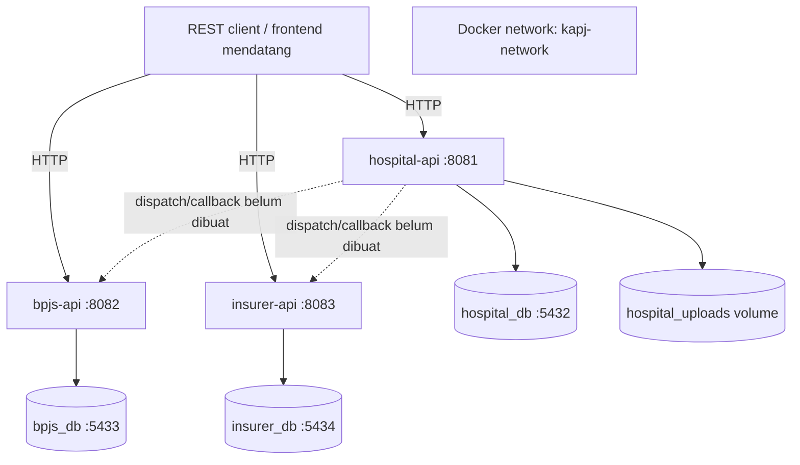

# Implementasi Backend Dev A

> **Status dokumen:** ringkasan implementasi di repository per 22 November 2026  
> **Cakupan:** Fase 0, Fase 1, dan Fase 3 bagian Dev A  
> **Belum termasuk:** pekerjaan Dev B serta Fase 4 yang menunggu integrasi bersama

Dokumen ini menjelaskan kode backend yang sudah ditambahkan, cara menjalankan dan mengujinya, kontrak API yang tersedia, serta bagian yang belum selesai. Dokumen ini menjadi referensi utama implementasi; [infografik PNG](./implementasi-backend-dev-a.png) tersedia sebagai ringkasan visual.

## 1. Ringkasan

Repository sebelumnya berisi README dan rencana ticketing, belum berisi aplikasi backend. Implementasi menambahkan satu aplikasi Go yang dapat dijalankan sebagai tiga proses terpisah:

| Service | API lokal | Database lokal | Peran saat ini |
|---|---:|---:|---|
| Hospital | `8081` | `5432`, `hospital_db` | API utama untuk pasien, kasus, dokumen, split bill, dan keuangan |
| BPJS | `8082` | `5433`, `bpjs_db` | Fondasi service, health check, login demo, profil, dan snapshot klaim seed |
| Asuransi swasta | `8083` | `5434`, `insurer_db` | Fondasi service, health check, login demo, profil, dan snapshot klaim seed |

Ketiga proses memakai binary yang sama (`cmd/api`) dengan konfigurasi `SERVICE` berbeda. Setiap proses memiliki koneksi ke database sendiri; antar-service tidak membaca database service lain.

> Compose saat ini menjalankan **tiga API dan tiga database**. Frontend Next.js belum ada di repository, sehingga port UI `3001–3003` belum dilayani.

## 2. Cakupan berdasarkan fase/tiket

| Fase | Bagian Dev A | Status implementasi |
|---|---|---|
| Fase 0 | `T-001` Compose dan scaffolding; `T-002` migrasi; `T-003` seed; `T-004` shared packages | Fondasi tersedia dan cold-start Docker diuji |
| Fase 1 | `T-101`–`T-108`: auth/config, pasien, kasus, dokumen, split bill | Hospital API tersedia |
| Fase 3 | `T-301`–`T-303`: invoice, pembayaran, ringkasan dan rekonsiliasi | Hospital API tersedia |
| Fase 2 | `T-201`–`T-206`, milik Dev B | Belum diimplementasikan |
| Fase 3 | `T-304`, milik Dev B | Belum diimplementasikan |
| Fase 4 | `T-401` dan `T-402`, dikerjakan bersama | Sengaja ditunda sampai pekerjaan Dev B siap |

Status di atas tidak berarti seluruh UI atau seluruh alur end-to-end sudah selesai. Detail keterbatasan dijelaskan pada [bagian yang belum dikerjakan](#11-batasan-dan-pekerjaan-selanjutnya).

## 3. Arsitektur dan startup



Saat setiap proses API dimulai:

1. Memastikan `SERVICE` bernilai `hospital`, `bpjs`, atau `insurer`.
2. Memastikan `JWT_SECRET` dan `KAPJ_SERVICE_KEY` masing-masing memiliki minimal 32 karakter.
3. Membuka koneksi PostgreSQL dan memastikan database dapat di-ping.
4. Memilih file migrasi untuk service tersebut, menjalankannya di transaksi database, lalu menjalankan seeder idempotent.
5. Mendaftarkan route untuk service.

Container database memiliki health check `pg_isready`; API menunggu database terkait berstatus sehat sebelum dimulai. Endpoint `GET /health` mengecek koneksi database dan mengembalikan nama service serta status database.

## 4. Struktur kode

```text
cmd/api/main.go                       proses HTTP dan shutdown
internal/database/database.go         pool PostgreSQL dan migrasi embedded
internal/database/migrations/          skema untuk tiga database
internal/seed/seeder.go                akun dan data simulasi
internal/server/                       router dan handler API
pkg/contracts/fhir_dto.go              DTO FHIR-inspired
pkg/httpclient/webhook_client.go        HTTP client untuk webhook
pkg/middleware/auth.go                 JWT dan service-key middleware
pkg/response/response.go                envelope response dan error
docker-compose.yml                     tiga API, tiga database, network/volume
Dockerfile                             build dan runtime image Go
.env.example                           contoh konfigurasi lokal
```

Binary Go berbasis Go 1.24 dan menggunakan `pgx` untuk PostgreSQL, `golang-jwt` untuk JWT, serta `bcrypt` untuk hash password demo.

## 5. Konfigurasi lokal dan menjalankan

### Prasyarat

- Docker dan Docker Compose.
- Go 1.24 atau lebih baru untuk menjalankan tes/build di host.
- Port `5432–5434` dan `8081–8083` tersedia.

### Menyiapkan environment

Di Windows PowerShell:

```powershell
Copy-Item .env.example .env
```

Edit `.env` sebelum menjalankan service:

- Ganti `JWT_SECRET` dan `KAPJ_SERVICE_KEY` dengan nilai acak minimal 32 karakter.
- `.env` diabaikan oleh Git; jangan commit secret.
- Jika mengganti `POSTGRES_USER` atau `POSTGRES_PASSWORD`, sesuaikan juga ketiga URL database (`HOSPITAL_DB_URL`, `BPJS_DB_URL`, `INSURER_DB_URL`) agar kredensial URL cocok dengan kredensial container Postgres.

Jalankan semua service:

```powershell
docker compose up --build -d
docker compose ps
```

Periksa health API:

```powershell
Invoke-RestMethod http://localhost:8081/health
Invoke-RestMethod http://localhost:8082/health
Invoke-RestMethod http://localhost:8083/health
```

Hentikan container tanpa menghapus data volume:

```powershell
docker compose down
```

Perintah `docker compose down -v` juga menghapus volume database dan upload; gunakan hanya jika memang ingin mengulang setup dari data kosong.

## 6. Database dan data demo

### `hospital_db`

Migrasi membuat tabel:

- `users`, `system_configs`
- `patients`, `patient_coverages`
- `medical_cases`, `case_bill_items`
- `case_documents`, `subclaims`, `split_bill_simulations`
- `payment_transactions`
- `case_communications`, `activity_logs`, `notifications`

Constraint utama meliputi NIK pasien unik, kode pasien/kasus/subklaim unik, foreign key antar entitas, batas enum status, dan nilai finansial non-negatif.

Seeder Hospital menambahkan akun demo, lima pasien simulasi, kepesertaan BPJS dan sebagian polis swasta, kasus `KAS-2026-001` bernilai Rp125.000.000, empat baris tagihan, serta contoh subklaim dan simulasi split bill.

### `bpjs_db` dan `insurer_db`

Kedua database memiliki tabel akun pengguna, klaim dengan snapshot JSONB, serta log klaim. Seeder menambahkan akun demo dan snapshot klaim yang cocok dengan kode contoh Hospital.

Data klaim seed ini adalah fixture awal per database. **Belum ada dispatcher yang mengirim perubahan Hospital ke database payer**, karena pengiriman klaim dan callback termasuk tiket Dev B.

## 7. Auth, kontrak response, dan audit

### Auth

- Login mengembalikan JWT HS256 dengan masa berlaku 8 jam.
- Endpoint bisnis Hospital dan akses file `/uploads/...` memerlukan `Authorization: Bearer <token>`.
- Token membawa ID, email, nama, dan role. Saat ini middleware memastikan token valid; pengecekan otorisasi per-role belum diterapkan di tiap route.
- Logout bersifat stateless: server meminta client membuang token, tetapi token yang sudah diterbitkan tetap berlaku sampai kedaluwarsa.
- Middleware `X-KAPJ-Service-Key` dan pemeriksaan `X-KAPJ-Source-Node` tersedia untuk route internal mendatang. Route webhook belum didaftarkan.

### Envelope response

Sukses satu data:

```json
{ "success": true, "data": {} }
```

Sukses list menambahkan `meta` dengan pagination:

```json
{ "success": true, "data": [], "meta": { "page": 1, "limit": 20, "total": 0 } }
```

Error validasi memakai `success: false` dan objek `error` (`code`, `message`, opsional `details[]`). Contoh status penting: `401` token/kredensial tidak valid, `403` service key tidak valid, `404` resource tidak ditemukan, `409` duplikasi, `422` validasi bisnis, `502` belum digunakan karena dispatcher payer belum dibuat.

### Audit

Handler pasien, kasus, dokumen, split bill, invoice, dan pembayaran menulis aktivitas ke `activity_logs`. Komunikasi dan notifikasi sudah memiliki tabel skema, tetapi API pengelolaannya belum tersedia.

## 8. Referensi endpoint Hospital

Semua endpoint di bawah memakai base URL `http://localhost:8081`. Kecuali login dan health check, endpoint memerlukan Bearer JWT. Parameter ID adalah ID numerik database.

### Health, auth, dan konfigurasi

| Method | Path | Keterangan |
|---|---|---|
| `GET` | `/health` | Status koneksi DB; tidak perlu token |
| `POST` | `/api/auth/login` | Login email/password |
| `POST` | `/api/auth/logout` | Instruksi client membuang token |
| `GET` | `/api/me` | Profil pengguna dari token |
| `GET` | `/api/system/config` | Konfigurasi mode/preset |
| `PATCH` | `/api/system/simulation-mode` | Simpan `COB` atau `NON_COB` dan preset |

### Pasien

| Method | Path | Keterangan |
|---|---|---|
| `GET` | `/api/patients` | List, pencarian, filter payer/tab, pagination |
| `GET` | `/api/patients/summary` | Ringkasan direktori |
| `POST` | `/api/patients/verify-bpjs` | Verifikasi BPJS simulasi |
| `POST` | `/api/patients` | Registrasi pasien, coverage, dokumen identitas |
| `GET` | `/api/patients/{id}` | Profil, coverage, riwayat kasus dan aktivitas |
| `PATCH` | `/api/patients/{id}` | Update kontak/alamat |
| `PATCH` | `/api/patients/{id}/coverages` | Update limit/status coverage |

Filter list pasien:

- `q`: pencarian nama, NIK, atau kode pasien.
- `tab`: `ALL`, `ACTIVE_CASE`, `ACTION_REQUIRED`, `UNPAID`.
- `payer`: `ALL`, `BPJS`, `PRIVATE_INSURANCE`.
- `page` dan `limit` untuk pagination; nilai limit default 20 dan dibatasi maksimum 100.

Verifikasi BPJS hanya memvalidasi format nomor 13 digit lalu mengembalikan data peserta simulasi; tidak memanggil VClaim.

### Kasus

| Method | Path | Keterangan |
|---|---|---|
| `POST` | `/api/cases` | Buat episode perawatan dan checklist dokumen |
| `GET` | `/api/cases` | List kasus, pencarian, filter, pagination |
| `GET` | `/api/cases/{id}` | Detail pasien/kasus, item biaya, dokumen, subklaim, split dan aktivitas |
| `PATCH` | `/api/cases/{id}` | Update informasi kasus yang didukung handler |
| `PATCH` | `/api/cases/{id}/discharge-checklist` | Set `{ "complete": true/false }` |

Kasus mensyaratkan pasien terdaftar, diagnosis ICD-10, DPJP, tanggal masuk valid, sekurangnya satu item biaya, dan coverage BPJS aktif. Nominal tagihan dihitung dari jumlah `unit_price × quantity`. Tanggal keluar, jika diisi, tidak boleh lebih awal daripada tanggal masuk.

Mode kasus dapat `COB` atau `NON_COB`. Jika tidak dikirim, mode dibaca dari `system_configs`. Checklist default menyiapkan dokumen BPJS (`SEP`, `RESUME_MEDIS`, `BILLING_RINCI`) dan, untuk COB dengan coverage swasta, dokumen tambahan (`GL_ASURANSI`, `RINCIAN_BHP`).

Filter list kasus:

- `tab`: `ALL`, `NEEDS_DOCUMENTS`, `IN_REVIEW`, `READY_RECONCILE`.
- `status`: filter status pembayaran.
- `q`, `page`, `limit`.

### Dokumen

| Method | Path | Keterangan |
|---|---|---|
| `POST` | `/api/documents/upload` | Upload multipart pada field `file` |
| `POST` | `/api/cases/{id}/documents` | Kaitkan metadata file ke kasus/checklist |
| `GET` | `/api/cases/{id}/documents` | Dokumen, status kelengkapan, missing list |
| `DELETE` | `/api/cases/{id}/documents/{docId}` | Hapus metadata dan file lokal |
| `GET` | `/uploads/{path}` | Baca file; memerlukan JWT |

Format yang diterima PDF/JPG/JPEG/PNG, maksimum 10 MB. Handler memeriksa ekstensi sekaligus signature MIME, membuat nama penyimpanan acak di bawah `UPLOAD_DIR/<tahun>/<bulan>/`, dan mengembalikan URL `/uploads/...`. `POST /api/cases/{id}/documents` mengaitkan file ke checklist dan menaikkan workflow ke tahap dokumen bila semua dokumen wajib valid.

### Split bill

| Method | Path | Keterangan |
|---|---|---|
| `POST` | `/api/cases/{id}/split-bill/calculate` | Hitung dan simpan simulasi |
| `GET` | `/api/cases/{id}/split-bill` | Baca simulasi dan alokasi baris tagihan |
| `POST` | `/api/cases/{id}/split-bill/apply` | Terapkan alokasi dan buat/update draft subklaim |

`split_method` adalah `PERCENTAGE` atau `NOMINAL`.

- `PERCENTAGE`: validasi angka non-negatif dan total persentase maksimal 100%. Nilai bagian pasien dihitung sebagai sisa tagihan sehingga jumlah nominal selalu seimbang.
- `NOMINAL`: nominal BPJS dan, untuk COB, nominal insurer wajib tidak negatif serta jumlah keduanya tidak boleh melebihi total tagihan. Sisa menjadi bagian pasien.
- `NON_COB`: bagian insurer dikunci menjadi nol.
- Pembagian per baris memakai pembulatan integer dengan distribusi sisa agar total per payer dan per item tetap seimbang, tanpa porsi payer melebihi nilai item.
- `apply` tidak mengubah subklaim yang sudah bukan `DRAFT`.

Contoh test: tagihan Rp125.000.000 dengan BPJS 30%, insurer 58%, pasien 12% menghasilkan Rp37.500.000, Rp72.500.000, dan Rp15.000.000.

### Invoice dan pembayaran

| Method | Path | Keterangan |
|---|---|---|
| `GET` | `/api/cases/{id}/invoice` | Invoice, allocations, approved/paid/open balance |
| `POST` | `/api/cases/{id}/invoice/send-patient` | Catat aktivitas invoice dibagikan |
| `POST` | `/api/cases/{id}/payments` | Catat pembayaran BPJS/swasta/pasien |
| `GET` | `/api/payments` | Daftar kasus dan transaksi |
| `GET` | `/api/payments/summary` | Ringkasan agregat keuangan |
| `GET` | `/api/payments/bank-reconciliation` | Feed transaksi lokal untuk pencocokan |

Pembayaran harus positif, memiliki metode pembayaran, dan tidak melebihi saldo payer maupun saldo kasus. Jika `subclaim_id` dikirim untuk pembayaran payer, ID tersebut harus berasal dari kasus dan jenis payer yang sama. Transaksi memakai kode `TRX-YYYY-NNNN`.

Status kasus:

- `UNPAID`: belum ada pembayaran.
- `PARTIAL`: ada pembayaran tetapi totalnya masih di bawah tagihan.
- `PAID`: total pembayaran mencapai tagihan; workflow dinaikkan ke tahap 6.

Feed rekonsiliasi berasal dari `payment_transactions`, bukan integrasi mutasi bank. Endpoint kirim invoice hanya mencatat activity log; belum ada email/SMS/pengiriman eksternal.

## 9. Contoh alur yang tersedia

1. Login Hospital untuk memperoleh token.
2. Buat pasien dengan BPJS dan opsional polis swasta.
3. Buat kasus dengan item tagihan; backend membuat checklist dokumen.
4. Upload dokumen lalu kaitkan URL file dengan checklist.
5. Hitung simulasi split bill, kemudian apply.
6. Setelah data approval payer tersedia, baca invoice dan catat pembayaran.
7. Saat akumulasi pembayaran sama dengan total tagihan, kasus berstatus `PAID`.

Langkah adjudikasi/approval di tengah alur **belum dapat dilakukan melalui API ini**; langkah tersebut membutuhkan service Dev B.

## 10. Validasi yang dijalankan

Validasi terakhir mencakup:

```text
go test ./...
go vet ./...
go build ./cmd/api
docker compose config --quiet
```

Docker juga diuji dari volume baru: migrasi, seed tiga service, dan health check berhasil. Smoke test lokal mencakup demo login, list pasien, registrasi pasien, pembuatan kasus, checklist dokumen, split bill, invoice, pencatatan pembayaran, settlement, penolakan request tanpa token, dan penolakan overpayment. Container uji dihentikan setelah pemeriksaan.

## 11. Batasan dan pekerjaan selanjutnya

### Milik Dev B yang belum tersedia

- Dispatcher pengajuan subklaim dari Hospital.
- Receiver klaim dan adjudikasi BPJS serta asuransi swasta.
- Callback keputusan ke Hospital, rekonsiliasi approval, komunikasi, dan notifikasi.
- Dashboard reviewer payer dan dashboard operasional/action-required Hospital.

Service BPJS dan insurer saat ini hanya menyediakan `/health`, `POST /api/auth/login`, dan `GET /api/me`, ditambah data seed database.

### Fase 4, dikerjakan bersama kemudian

- `T-401`: E2E lintas service untuk alur COB, revisi, Non-CoB, dan cold start.
- `T-402`: OpenAPI/Swagger, koleksi `.http` lokal, serta frontend handoff.
- UI Next.js belum menjadi bagian dari repository saat ini.

### Batasan simulasi dan operasional

- Verifikasi BPJS adalah dummy lokal, bukan koneksi BPJS/VClaim.
- Logout tidak mencabut token server-side; client membuang token dan menunggu expiry 8 jam.
- Role disimpan dalam JWT, tetapi otorisasi spesifik per role belum dipasang pada route.
- Middleware service-key dan HTTP client tersedia sebagai fondasi, belum ada route webhook yang menggunakannya.
- `notifications` dan `case_communications` sudah ada di skema, belum ada endpoint pengelolaannya.
- `.env.example` berisi nilai contoh; ganti secret sebelum menjalankan lokal dan jangan gunakan untuk deployment.

## 12. Referensi

- [Rencana ticketing backend](./kapj_flow_backend_engineering_ticketing_plan.md)
- [README proyek dan quick start](../../README.md)
- [Infografik ringkas implementasi Dev A (PNG)](./implementasi-backend-dev-a.png)
