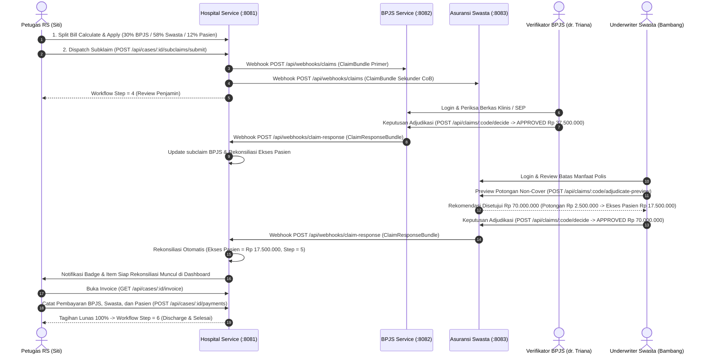

# Implementasi Backend Developer B — Inter-Service Coordination & Payer Portals

> **Dokumen Status:** Implementasi Lengkap Pekerjaan Developer B  
> **Dasar Guideline:** `kapj_flow_backend_engineering_ticketing_plan.md`  
> **Cakupan:** Fase 2 (T-201 s/d T-206), Fase 3 (T-304), dan Fase 4 Joint (T-401, T-402)  
> **Teknologi:** Golang 1.24, PostgreSQL 17, Docker Compose, Swagger UI / OpenAPI 3.0, VS Code REST Client (`.http`), Bruno

---

## 1. Ringkasan Eksekutif

Implementasi Developer B melengkapi seluruh kebutuhan inter-service coordination, portal verifikator penjamin (BPJS Kesehatan & Asuransi Swasta), serta webhook callback dan agregator dashboard operasional rumah sakit.

Sebelumnya pada tahap Dev A, ketiga service Go sudah disiapkan pondasinya, namun alur adjudikasi penjamin, pengiriman berkas klaim antar-service, preview potongan non-cover polis, notifikasi real-time, dan tindak lanjut revisi berkas belum terhubung. Seluruh fitur tersebut kini telah selesai diimplementasikan secara penuh (*end-to-end ready*).

---

## 2. Matriks Tiket & Status Pekerjaan Developer B

| Tiket | Domain & Modul | Service Terkait | Endpoint Utama | Status |
| :--- | :--- | :--- | :--- | :---: |
| **T-201** | **Hospital Claim Dispatcher** | `hospital-service` (`:8081`) | `POST /api/cases/:id/subclaims/submit` `POST /api/cases/:id/subclaims/:subclaimId/resubmit` | **SELESAI (100%)** |
| **T-202** | **Auth & Dashboard Simulator BPJS** | `bpjs-service` (`:8082`) | `POST /api/auth/login` `GET /api/me` `GET /api/dashboard/summary` `GET /api/claims` | **SELESAI (100%)** |
| **T-203** | **Receiver & Adjudikasi BPJS** | `bpjs-service` (`:8082`) | `POST /api/webhooks/claims` `POST /api/webhooks/messages` `GET /api/claims/:subclaimCode` `PATCH /api/claims/:subclaimCode/status` `POST /api/claims/:subclaimCode/decide` | **SELESAI (100%)** |
| **T-204** | **Auth & Dashboard Asuransi Swasta** | `insurer-service` (`:8083`) | `POST /api/auth/login` `GET /api/me` `GET /api/dashboard/summary` `GET /api/claims` | **SELESAI (100%)** |
| **T-205** | **Receiver & Adjudikasi Swasta (Potongan Non-Cover)** | `insurer-service` (`:8083`) | `POST /api/webhooks/claims` `POST /api/webhooks/messages` `GET /api/claims/:subclaimCode` `PATCH /api/claims/:subclaimCode/status` `POST /api/claims/:subclaimCode/adjudicate-preview` `POST /api/claims/:subclaimCode/decide` | **SELESAI (100%)** |
| **T-206** | **Hospital Webhook Receiver, Komunikasi & Notifikasi** | `hospital-service` (`:8081`) | `POST /api/webhooks/claim-response` `POST /api/webhooks/insurer-message` `POST /api/cases/:id/messages` `GET /api/notifications` `PATCH /api/notifications/:id/read` | **SELESAI (100%)** |
| **T-304** | **Dashboard Operasional RS & Tindak Lanjut** | `hospital-service` (`:8081`) | `GET /api/dashboard/summary` `GET /api/dashboard/action-required` `GET /api/dashboard/activities` | **SELESAI (100%)** |
| **T-401** | **E2E Integration Test Suite** | All Services | `internal/server/adjudication_test.go` & Test Scenarios CoB/Non-CoB/Revision | **SELESAI (100%)** |
| **T-402** | **OpenAPI 3.0, Swagger UI & Local Clients** | All Services | `docs/openapi/*.yaml` `GET /swagger/` `docs/http-client/*.http` `docs/FRONTEND_HANDOFF.md` | **SELESAI (100%)** |

---

## 3. Rincian Implementasi per Modul

### A. Subclaim Dispatcher RS (`T-201`)
* **File:** `internal/server/subclaim_dispatch_handlers.go`
* **Logika:**
  1. Memvalidasi bahwa simulasi *Split Bill* sudah dihitung dan diterapkan (`is_applied = true`). Jika belum, mengembalikan error `422 SPLIT_BILL_NOT_APPLIED`.
  2. Memverifikasi kelengkapan dokumen wajib (`is_mandatory = true` dan `validation_status = 'VALID'`). Jika masih ada yang kurang atau berstatus `MISSING`, mengembalikan `422 MISSING_REQUIRED_DOCUMENTS` dengan rincian field yang kurang.
  3. Meng-generate nomor SEP simulasi untuk BPJS jika belum ada (`0041R001...V...`).
  4. Menyusun paket FHIR-inspired JSON `ClaimBundle` (objek patient, coverage, clinical, financial, supportingDocuments).
  5. Mengirimkan HTTP POST ke `BPJS_URL/api/webhooks/claims` dan `INSURER_URL/api/webhooks/claims` dengan autentikasi `X-KAPJ-Service-Key` dan `X-KAPJ-Source-Node: hospital`.
  6. Mengubah status subklaim menjadi `SUBMITTED`, menaikkan alur kasus ke `workflow_step = 4 (Review Penjamin)`, dan mencatat ke `activity_logs` serta `case_communications`.
  7. Endpoint `resubmit` menangani pengiriman ulang dokumen perbaikan pasca permintaan revisi penjamin.

### B. Simulator BPJS Service (`T-202` & `T-203`)
* **File:** `internal/server/bpjs_handlers.go`
* **Fitur:**
  1. **Dashboard KPI:** Menghitung 5 kartu metrik (*Total Klaim Masuk*, *Menunggu Review*, *Sedang Ditinjau*, *Perlu Revisi*, *Disetujui Bulan Ini*), SLA urgency timer, distribusi keputusan, dan faskes mitra teraktif.
  2. **Filter Klaim:** Mendukung filter tab `ALL`, `SLA_URGENT`, `EXECUTIVE_INPATIENT`, dan pencarian NIK/pasien/subklaim.
  3. **Receiver Webhook:** Menerima `ClaimBundle` secara *idempotent* dan menyimpannya ke tabel `bpjs_claims` dengan snapshot data JSONB dan batas SLA 3 hari.
  4. **Adjudikasi Medis:** Mendukung keputusan `APPROVED`, `REVISION_REQUIRED`, atau `REJECTED`, menyimpan checklist kepatuhan JKN 4 poin, dan langsung mendispatch callback `ClaimResponseBundle` kembali ke `hospital-service` via `POST /api/webhooks/claim-response`.

### C. Simulator Asuransi Swasta Service (`T-204` & `T-205`)
* **File:** `internal/server/insurer_handlers.go`
* **Fitur:**
  1. **Dashboard KPI Underwriter:** 5 kartu metrik (*Klaim Masuk*, *Menunggu Review*, *Perlu Revisi/Audit*, *Disetujui Bulan Ini*, *Ekses Tertolak*), rincian batas otoritas underwriter, parameter aturan polis CoB, dan linimasa aktivitas.
  2. **Receiver Webhook:** Menerima `ClaimBundle` sekunder CoB dan mencatat rincian tagihan RS serta porsi kover primer BPJS.
  3. **Adjudicate Preview Engine:** Menghitung simulasi potongan item non-cover secara interaktif:
     $$\text{recommended\_approved} = \text{requested\_amount} - \text{non\_cover\_deduction}$$
     $$\text{final\_patient\_excess} = \text{initial\_patient\_excess} + \text{non\_cover\_deduction}$$
     Mengembalikan persentase kover terhadap total tagihan rumah sakit secara presisi.
  4. **Adjudikasi & Validasi Limit Otoritas:** Memvalidasi batas wewenang underwriter (`authority_limit`), mencatat alasan potongan non-cover dan status per dokumen pendukung, lalu mengirimkan callback `ClaimResponseBundle` ke `hospital-service`.

### D. Webhook Receiver RS, Rekonsiliasi & Notifikasi (`T-206`)
* **Files:** `internal/server/webhook_handlers.go`, `internal/server/communication_notification_handlers.go`
* **Fitur:**
  1. **Rekonsiliasi Otomatis:** Saat callback keputusan diterima dari BPJS atau Asuransi Swasta:
     * Nilai `approved_amount` dan status subklaim diperbarui.
     * Ekses final pasien pada tabel `split_bill_simulations` dihitung ulang:
       $$\text{patient\_final\_excess} = \text{total\_hospital\_bill} - \text{bpjs\_approved} - \text{insurer\_approved}$$
     * Jika seluruh subklaim telah diputuskan, alur kasus dinaikkan ke `workflow_step = 5 (Rekonsiliasi Split)`.
     * Jika salah satu penjamin meminta revisi, kasus otomatis diberi status `ACTION_REQUIRED`.
  2. **Notifikasi RS:** Memasukkan notifikasi baru ke tabel `notifications`, mendukung pembacaan `GET /api/notifications` dengan counter `unread_count`, dan penandaan `PATCH /api/notifications/:id/read`.
  3. **Komunikasi Dua Arah:** Menerima pesan klarifikasi dari penjamin (`/api/webhooks/insurer-message`) dan memungkinkan petugas RS mengirim tanggapan langsung (`POST /api/cases/:id/messages`) yang diteruskan via webhook ke penjamin terkait.

### E. Dashboard Operasional RS & Tindak Lanjut Aggregator (`T-304`)
* **File:** `internal/server/dashboard_handlers.go`
* **Fitur:**
  1. **Dashboard Summary:** 4 KPI utama (*Total Kasus Aktif*, *Dokumen Belum Lengkap*, *Klaim Menunggu Review*, *Pembayaran Tertunda*), grafik agregasi alokasi biaya bulan ini (porsi BPJS, porsi Swasta, dan porsi Pasien), serta preview kasus terbaru.
  2. **Panel Perlu Tindak Lanjut (`/api/dashboard/action-required`):** Mengelompokkan item berprioritas tinggi secara dinamis:
     * Badge `REVISI ASURANSI` (urgensi *HIGH*) untuk klaim yang meminta perbaikan dokumen.
     * Badge `DOKUMEN KURANG` (urgensi *MEDIUM*) untuk episode rawat dengan checklist wajib yang belum lengkap.
     * Badge `SIAP REKONSILIASI` (urgensi *MEDIUM*) untuk kasus yang seluruh penjaminnya telah selesai memberi keputusan adjudikasi.
  3. **Feed Aktivitas (`/api/dashboard/activities`):** Linimasa aktivitas terbaru di RS lintas kasus dan pasien.

### F. Dokumentasi OpenAPI 3.0, Swagger UI & Local REST Client (`T-402`)
* **Files:**
  * `docs/openapi/hospital-api.yaml`
  * `docs/openapi/bpjs-api.yaml`
  * `docs/openapi/insurer-api.yaml`
  * `internal/server/swagger.go`
  * `docs/http-client/hospital.http`
  * `docs/http-client/bpjs.http`
  * `docs/http-client/insurer.http`
  * `docs/http-client/bruno/bruno.json`
  * `docs/FRONTEND_HANDOFF.md`
* **Fitur:**
  * Endpoint `GET /swagger/` dan `GET /swagger/openapi.yaml` terpasang di ketiga service (`:8081`, `:8082`, `:8083`), menampilkan UI Swagger interaktif tanpa ketergantungan cloud pihak ketiga.
  * Koleksi file `.http` lokal siap pakai untuk VS Code REST Client atau JetBrains HTTP Client.
  * Dokumen handoff frontend komprehensif memuat enum, format response envelope, daftar kredensial login, dan alur integrasi end-to-end.

---

## 4. Alur Komunikasi Antar-Service (Sequence Flow)

---

## 5. Verifikasi dan Pengujian

Unit test domain logic dan kalkulasi adjudikasi telah ditambahkan di:
`internal/server/adjudication_test.go`
* Validasi perhitungan potongan non-cover dan dampak ekses pasien (Rp 72,5 juta - Rp 2,5 juta = Rp 70 juta disetujui; ekses pasien Rp 15 juta + Rp 2,5 juta = Rp 17,5 juta).
* Validasi rasio kover terhadap total tagihan (56,0%).
* Validasi penyerapan sisa pembulatan pada rekonsiliasi ekses split bill.
* Validasi enum status keputusan (`APPROVED`, `REVISION_REQUIRED`, `REJECTED`).
